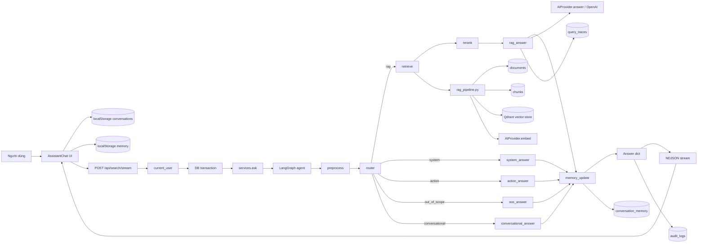
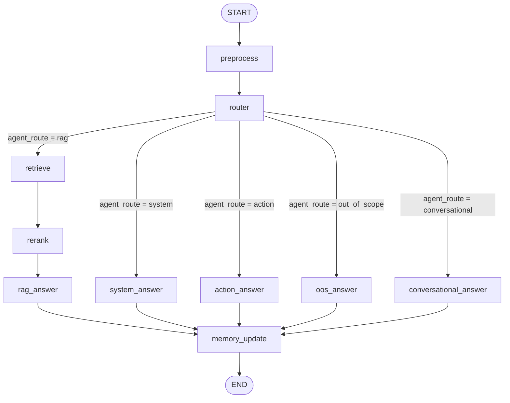
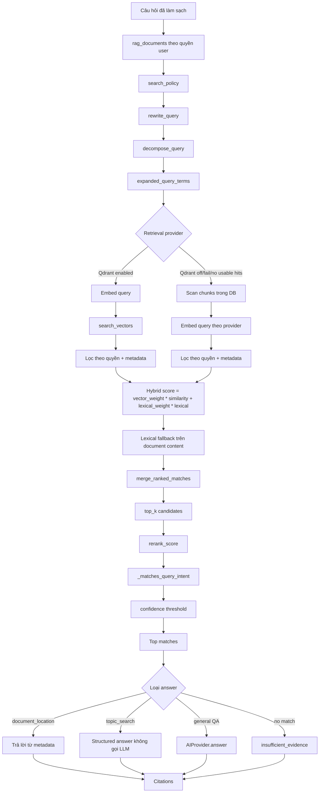
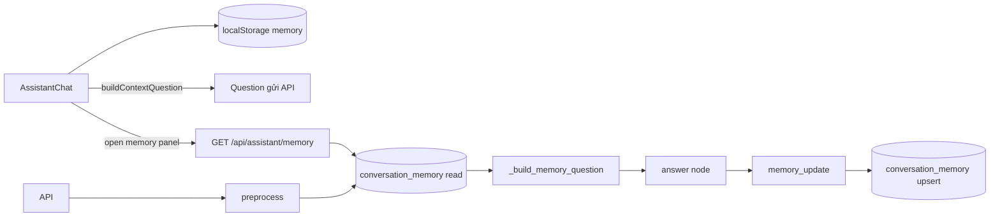
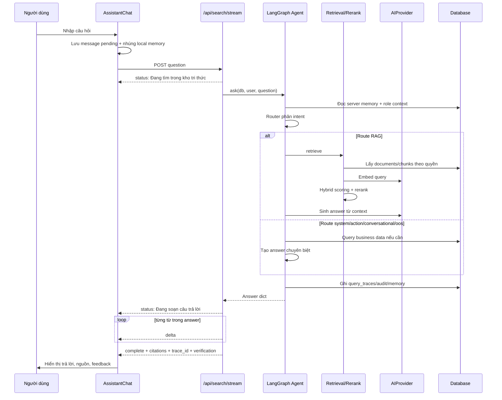

# Phân tích cấu trúc luồng xử lý Chatbot EduVault v4

Tài liệu này tập trung vào luồng xử lý chatbot hiện tại trong v4, từ giao diện người dùng đến backend LangGraph, RAG, bộ nhớ hội thoại, trích dẫn nguồn và phản hồi streaming.

## 1. Tổng quan kiến trúc

Chatbot hiện được chia thành 4 lớp chính:

1. **Frontend chat UI**
   - File chính: `frontend/components/assistant-chat.tsx`
   - Trang toàn màn hình: `frontend/app/assistant/page.tsx`
   - UI phụ: `frontend/components/assistant/*`

2. **API backend**
   - Endpoint thường: `POST /api/search`
   - Endpoint streaming: `POST /api/search/stream`
   - Feedback: `POST /api/search/feedback`
   - Memory: `GET /api/assistant/memory`, `DELETE /api/assistant/memory`
   - File chính: `src/eduvault/main.py`

3. **LangGraph agent**
   - File chính: `src/eduvault/agent.py`
   - Node chính: `preprocess -> router -> route-specific node -> memory_update`

4. **Service RAG / AI / dữ liệu**
   - RAG runtime pipeline: `src/eduvault/rag_pipeline.py`
   - RAG và business logic: `src/eduvault/services.py`
   - AI provider, OpenAI fallback/local embedding: `src/eduvault/ai.py`
   - Bảng liên quan: `documents`, `chunks`, `query_traces`, `search_feedback`, `conversation_memory`, `audit_logs`

## 2. Sơ đồ kiến trúc chatbot



## 3. Luồng xử lý từ frontend

### 3.1 Khởi tạo giao diện

`frontend/app/assistant/page.tsx` chỉ render:

```tsx
<AssistantChat variant="page" />
```

Toàn bộ trạng thái hội thoại nằm trong `AssistantChat`:

- `conversations`: danh sách hội thoại local.
- `activeId`: hội thoại đang mở.
- `question`: câu hỏi đang nhập.
- `loading`, `error`: trạng thái gửi câu hỏi.
- `memory`: bộ nhớ local ở trình duyệt.
- `serverMemory`: bộ nhớ đọc từ backend khi mở panel bộ nhớ.

Frontend lưu hội thoại theo user:

- `eduvault_conversations:v2:{user.code}`
- `eduvault_assistant_memory:{user.code}`

Điểm đáng chú ý: frontend có local memory riêng, backend cũng có server memory riêng. Khi gửi câu hỏi, frontend nhúng local memory vào prompt; backend sau đó lại đọc server memory và nhúng thêm lần nữa.

### 3.2 Gửi câu hỏi

Hàm `submit()` trong `AssistantChat` xử lý:

1. Lấy câu hỏi người dùng nhập.
2. Thêm message mới vào hội thoại local với trạng thái `streaming: true`.
3. Gọi:

```http
POST /api/search/stream
Content-Type: application/json

{
  "question": buildContextQuestion(displayQuestion, context, memory)
}
```

`buildContextQuestion()` có thể ghép thêm:

- Ngữ cảnh trang hiện tại.
- Bộ nhớ ngắn hạn local.
- Bộ nhớ dài hạn local.
- Câu hỏi thật của người dùng.

### 3.3 Nhận streaming

Frontend đọc response body bằng `ReadableStream` và parse từng dòng NDJSON:

- `status`: cập nhật trạng thái như “Đang tìm trong kho tri thức...”
- `delta`: nối thêm text vào câu trả lời đang hiển thị.
- `complete`: gắn citations, trace_id, intent, rewritten_query, verification.
- `error`: hiển thị lỗi.

Lưu ý quan trọng: backend hiện không stream trực tiếp từ LLM. Backend chạy xong `ask()` trước, sau đó tách `result["answer"]` thành từng từ và gửi từng `delta`. Vì vậy đây là **response streaming mô phỏng**, không phải token streaming từ model.

## 4. Luồng API backend

Trong `src/eduvault/main.py`:

```python
@app.post("/api/search")
def search(payload: Question, user: dict = Depends(current_user)):
    with transaction() as db:
        return ask(db, user, payload.question, payload.filters, payload.current_page)
```

```python
@app.post("/api/search/stream")
def search_stream(payload: Question, user: dict = Depends(current_user)):
    ...
    result = ask(db, user, payload.question, payload.filters, payload.current_page)
    ...
```

`Question` gồm:

- `question`: chuỗi câu hỏi, 2-1000 ký tự.
- `filters`: bộ lọc metadata tuỳ chọn.
- `current_page`: ngữ cảnh trang hiện tại tuỳ chọn.

Endpoint `/api/search/stream` trả `application/x-ndjson`, gồm các event:

```json
{"type":"status","message":"..."}
{"type":"delta","text":"..."}
{"type":"complete","citations":[],"scope":"public_or_owned","trace_id":"..."}
{"type":"error","message":"..."}
```

## 5. LangGraph multi-agent pipeline

`services.ask()` không còn xử lý trực tiếp. Nó delegate sang:

```python
_agent_module.run_agent(
    services_module=sys.modules[__name__],
    db=db,
    user=user,
    question=question,
    filters=filters,
    current_page=current_page,
)
```

Agent nằm trong `src/eduvault/agent.py`.

Từ bản refactor hiện tại, các node RAG trong agent gọi `src/eduvault/rag_pipeline.py` cho retrieval/rerank. Phần dựng câu trả lời cuối vẫn delegate về helper hiện có trong `services.py` để giữ tương thích với các formatter, policy helper và guardrail dùng chung.

### 5.1 Sơ đồ LangGraph



### 5.2 Node `preprocess`

Trách nhiệm:

- Tách câu hỏi thật bằng `_extract_actual_question()`.
- Đọc server-side memory từ `conversation_memory`.
- Xác định role người dùng.
- Tạo `role_ctx` bằng `build_role_context()`.
- Thêm `current_page` nếu có.

Output chính:

- `retrieval_query`
- `role`
- `role_ctx`
- `short_term`
- `long_term`

### 5.3 Node `router`

Router kiểm tra theo thứ tự:

1. `_is_out_of_scope_query(q)`
2. `_query_intent(q)`
3. `classify_query_intent(q)`

Sau đó route sang một trong 5 nhánh:

| Route | Khi nào dùng | Node xử lý |
|---|---|---|
| `rag` | Tra cứu/tổng hợp từ tài liệu | `retrieve -> rerank -> rag_answer` |
| `system` | Hỏi cách dùng hệ thống, upload, policy, status | `system_answer` |
| `action` | Cần query DB trực tiếp: tài liệu của tôi, thống kê, download, version | `action_answer` |
| `out_of_scope` | Câu hỏi ngoài phạm vi | `oos_answer` |
| `conversational` | Chào hỏi, hỏi chatbot là ai, follow-up hội thoại | `conversational_answer` |

## 6. Luồng RAG chi tiết



### 6.1 Retrieval

Hàm chính: `rag_pipeline.run_retrieval()`.

Các bước:

1. Lấy tài liệu user được phép xem bằng `rag_documents(db, user)`.
2. Lấy policy tìm kiếm bằng `search_policy(db)`.
3. Rewrite query bằng `rewrite_query()`.
4. Tách sub-query bằng `decompose_query()`.
5. Mở rộng terms bằng `expanded_query_terms()`.
6. Lọc tài liệu theo metadata `filters`.
7. Nếu provider là Qdrant và Qdrant bật:
   - Embed query bằng `ai_provider.embed()`.
   - Gọi `search_vectors()`.
   - Lấy chunk tương ứng từ DB.
   - Tính điểm hybrid.
8. Nếu Qdrant fail hoặc không có kết quả usable:
   - fallback sang database scan `chunks`.
   - audit `rag.qdrant_fallback`.
9. Chạy lexical fallback trên nội dung document.
10. Merge, sort và cắt top candidates.

Điểm hybrid:

```text
hybrid = similarity * vector_weight + lexical * lexical_weight
```

Mặc định được đọc từ search policy, ví dụ code đang dùng fallback:

- `vector_weight`: 0.38
- `lexical_weight`: 0.62

### 6.2 Rerank

Hàm chính: `rag_pipeline.run_rerank()`.

Các bước:

1. Tính `rerank_score()` cho candidates.
2. Cắt `rerank_k`.
3. Lọc theo intent bằng `_matches_query_intent()`.
4. Với intent tìm tài liệu, loại bớt doc type không phục vụ học thuật như CV/hồ sơ/tài liệu khác nếu có lựa chọn tốt hơn.
5. Chọn matches theo threshold:

```text
threshold = max(confidence_threshold, top_score * 0.35)
```

Nếu không có match:

- Với câu hỏi muốn sách/đề thi/AI: trả empty để tránh kéo nhầm tài liệu.
- Trường hợp khác: fallback lexical nếu score đủ `min_fallback_score`.

### 6.3 Tạo câu trả lời RAG

Hàm chính: `_build_rag_response()`.

Các nhánh quan trọng:

- **Access guard**: chặn câu hỏi đòi tài liệu private người khác, đề thi sắp thi, đáp án hoặc nội dung hạn chế.
- **No match**: trả `insufficient_evidence`, đồng thời kiểm tra có tài liệu chưa `INDEXED` khớp tên không.
- **document_location**: trả lời trực tiếp từ metadata tài liệu.
- **topic_search**: dùng `format_topic_search_answer()`, không gọi LLM.
- **general QA**: gọi `ai_provider.answer()` với context từ `document_metadata_context()`.
- **OCR/text extraction issue**: nếu chunk báo `TEXT_EXTRACTION_INSUFFICIENT`, trả hướng dẫn OCR/tải lại file.
- **LLM insufficient**: fallback sang câu trả lời có nguồn tối thiểu.

Output chính:

```json
{
  "answer": "...",
  "citations": [],
  "scope": "public_or_owned",
  "intent": "...",
  "rewritten_query": "...",
  "trace_id": "...",
  "trace": {},
  "verification": {},
  "pipeline": [],
  "suggested_actions": []
}
```

## 7. Nhánh system/action/conversational/out-of-scope

### 7.1 `system_answer`

Hàm: `_build_system_response()`.

Dùng cho:

- `upload_help`
- `policy_management`
- `user_management`
- `system_status`
- `onboarding_guide`
- `permission_request`

Đặc điểm:

- Không retrieval tài liệu.
- Có static guide cho các câu hỏi hướng dẫn.
- Với `system_status`, gọi `operations_status(db)` để trả trạng thái API, database, object storage, vector store, queue, backup.
- Có security refusal với yêu cầu nhạy cảm như token hoặc backup database.
- Với admin và intent `policy_management`, có thể gọi `preview_policy_action()` để tạo yêu cầu thay đổi policy cần xác nhận.

### 7.2 `action_answer`

Hàm: `_build_action_response()`.

Dùng cho các intent cần truy vấn dữ liệu hệ thống trực tiếp:

- `own_document_lookup`
- `analytics_query`
- `knowledge_gap_analysis`
- `version_management`
- `storage_suggestion`
- `document_recommendation`
- `download_document`

Đặc điểm:

- Không phải RAG thuần.
- Trả lời từ DB/business logic.
- Có thể trả citations có `asset_id` cho tải file.

### 7.3 `conversational_answer`

Hàm: `_build_conversational_response()`.

Dùng cho:

- Chào hỏi.
- Hỏi chatbot là ai.
- Follow-up kiểu “nói ngắn gọn”, “giải thích đơn giản”.

Đặc điểm:

- Không retrieval.
- Trả lời theo role người dùng.
- Vẫn ghi memory sau khi trả lời.

### 7.4 `oos_answer`

Hàm: `_build_oos_response()`.

Dùng khi `_is_out_of_scope_query()` phát hiện câu hỏi ngoài phạm vi, ví dụ:

- Hỏi ý kiến cá nhân.
- Yêu cầu tự đánh giá độ đúng.
- Nội dung không liên quan kho tri thức EduVault.

Đặc điểm:

- Không retrieval.
- Ghi `query_traces`.
- Audit `rag.ask`.
- Trả verification `out_of_scope`.

## 8. Bộ nhớ hội thoại



Có 2 tầng memory:

1. **Local memory trong trình duyệt**
   - Lưu câu hỏi gần đây.
   - Được nhúng vào request trước khi gửi backend.

2. **Server memory trong DB**
   - Bảng `conversation_memory`.
   - `short_term`: giữ 8 lượt gần nhất.
   - `long_term`: giữ 12 lượt có tín hiệu factual/navigational như tài liệu, folder, tải lên, policy, kho, file.

Điểm cần chú ý: vì frontend đã nhúng local memory và backend lại nhúng server memory, prompt có thể bị dài hoặc trùng ngữ cảnh nếu hội thoại kéo dài.

## 9. Trace, audit và feedback

### 9.1 Query trace

Các node trả lời thường ghi vào `query_traces`:

- `original_query`
- `rewritten_query`
- `intent`
- `retrieved_json`
- `citations_json`
- `created_at`

Trace giúp kiểm tra vì sao chatbot trả lời như vậy.

### 9.2 Audit

Các hành động chính ghi `audit_logs`, ví dụ:

- `rag.ask`
- `rag.qdrant_fallback`
- `rag.feedback`
- `download.intent`

### 9.3 Feedback

Frontend gửi:

```http
POST /api/search/feedback
```

Payload:

```json
{
  "trace_id": "...",
  "rating": "up | wrong_source | missing_document",
  "reason": "...",
  "detail": "câu hỏi"
}
```

Backend ghi bảng `search_feedback` và audit `rag.feedback`.

## 10. Cách AIProvider hoạt động

File: `src/eduvault/ai.py`.

### 10.1 Answer

`AIProvider.answer(question, contexts, fallback, instructions)`:

- Nếu không có OpenAI API key hoặc không có contexts: trả `fallback`.
- Nếu có context: gọi OpenAI Responses API.
- Context được ghép dạng:

```text
[title]
content...
```

- Có guardrail:
  - Chỉ dựa trên context được cung cấp.
  - Không viết phần nguồn trong thân câu trả lời.
  - Trả lời tiếng Việt tự nhiên.

### 10.2 Embedding

`AIProvider.embed(text)`:

- Nếu có API key: gọi OpenAI embeddings.
- Nếu lỗi hoặc bị ép local: dùng local hash vector 128 chiều.

Điểm cần chú ý: Qdrant thường cần vector dimension nhất quán với collection. Nếu collection là OpenAI embedding 1536 chiều mà fallback local 128 chiều được dùng sai chỗ, retrieval có thể lỗi và fallback sang database.

## 11. Các điểm mạnh hiện tại

- Có LangGraph rõ ràng, dễ mở rộng thêm node.
- Tách route RAG/system/action/conversational/out-of-scope khá tốt.
- Có access guard theo quyền tài liệu trước retrieval.
- Có Qdrant và fallback database khi vector store lỗi.
- Có trace, audit và feedback để debug chất lượng câu trả lời.
- Có nhánh system/action giúp chatbot làm được việc ngoài RAG tài liệu.
- Có xử lý riêng cho tài liệu chưa indexed và OCR insufficient.

## 12. Rủi ro và điểm cần cải thiện

1. **Streaming chưa phải LLM streaming thật**
   - Backend đang chạy xong `ask()` rồi mới chia câu trả lời thành từng từ.
   - Người dùng vẫn phải chờ toàn bộ retrieval + LLM hoàn tất trước khi thấy nội dung đầu tiên.

2. **Memory bị nhân đôi**
   - Frontend nhúng local memory.
   - Backend lại nhúng server memory.
   - Có thể gây lặp context, prompt dài, hoặc làm câu hỏi khó phân tích intent.

3. **Một số component assistant phụ có thể không còn được dùng**
   - Có các file `frontend/components/assistant/chat-header.tsx`, `chat-input.tsx`, `chat-history-list.tsx`, nhưng `AssistantChat` hiện tự render nhiều UI bên trong.
   - Nên kiểm tra để tránh tồn tại component chết hoặc lệch type.

4. **Legacy ask còn dài trong `services.py`**
   - `_ask_legacy()` vẫn tồn tại rất lớn và có logic trùng với agent mới.
   - Dễ gây nhầm khi bảo trì.
   - Retrieval/rerank runtime đã được tách sang `src/eduvault/rag_pipeline.py`, nhưng answer composer RAG và nhiều formatter vẫn còn nằm trong `services.py`.

5. **Encoding text trong một số file hiển thị bị lỗi mojibake**
   - Nhiều chuỗi tiếng Việt trong frontend/backend đang hiện dạng `Trợ lý`.
   - Không ảnh hưởng trực tiếp kiến trúc, nhưng ảnh hưởng UX và tài liệu debug.

6. **Qdrant fallback nên được quan sát kỹ**
   - Đã có audit `rag.qdrant_fallback`.
   - Nên theo dõi tần suất fallback để biết vector retrieval có đang hoạt động ổn không.

## 13. Đề xuất cải thiện luồng chatbot

1. **Chuẩn hóa một nguồn memory**
   - Chọn server memory là nguồn chính.
   - Frontend chỉ hiển thị lịch sử hội thoại, không nhúng local memory vào prompt.
   - Hoặc frontend chỉ gửi conversation_id, backend tự lấy memory.

2. **Streaming thật từ model**
   - Tách retrieval/rerank xong thì gọi LLM streaming.
   - Gửi token delta thật về frontend.
   - Giảm cảm giác chờ.

3. **Hoàn tất tách module RAG khỏi `services.py`**
   - Đề xuất module:
     - `rag/retrieval.py`
     - `rag/rerank.py`
     - `rag/answering.py`
     - `rag/trace.py`
   - Hiện đã có bước đầu là `rag_pipeline.py` cho retrieval/rerank runtime.
   - Bước tiếp theo nên tách `_build_rag_response()` và các formatter/citation helpers sang module answer/trace riêng.

4. **Lưu conversation_id server-side**
   - Hiện hội thoại chủ yếu lưu localStorage, đổi trình duyệt sẽ mất.
   - Có thể thêm bảng `chat_conversations`, `chat_messages`.
   - Khi đó trace, feedback, memory và UI history liên kết rõ hơn.

5. **Bổ sung telemetry cho từng node LangGraph**
   - Ghi thời gian `preprocess`, `retrieve`, `rerank`, `answer`.
   - Ghi provider retrieval: `qdrant` hay `database`.
   - Ghi số candidates/matches.

6. **Kiểm thử theo route**
   - Test `router` phân loại đúng.
   - Test `rag` không trả tài liệu private.
   - Test Qdrant fail thì fallback DB.
   - Test `system_status` không rò token/backup.
   - Test memory update không lưu câu vô nghĩa.

## 14. Tóm tắt luồng chính



## 15. File liên quan nhanh

| Thành phần | File |
|---|---|
| Trang assistant | `frontend/app/assistant/page.tsx` |
| Chat UI chính | `frontend/components/assistant-chat.tsx` |
| API search/stream/memory | `src/eduvault/main.py` |
| LangGraph agent | `src/eduvault/agent.py` |
| RAG runtime pipeline | `src/eduvault/rag_pipeline.py` |
| RAG/business logic | `src/eduvault/services.py` |
| AI/OpenAI/embedding/OCR | `src/eduvault/ai.py` |
| DB schema | `src/eduvault/database.py` |
