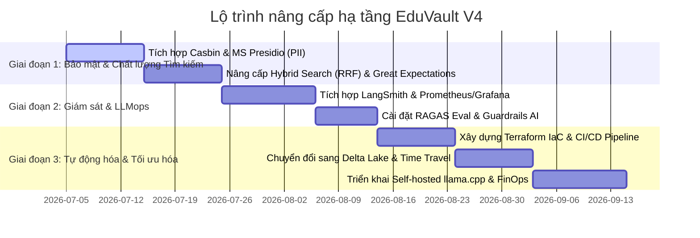

# BÁO CÁO CẢI THIỆN HẠ TẦNG HỆ THỐNG EDUVAULT V4
**Dựa trên các bài học hạ tầng từ Day 16 đến Day 25 (AIInAction - VinUni)**

---

## 1. Giới thiệu tổng quan về EduVault V4
Hệ thống **EduVault V4** hiện tại là một giải pháp quản lý kho lưu trữ tri thức kết hợp trợ lý AI (RAG Agent) phục vụ cho giảng viên và bộ môn học thuật. 

**Kiến trúc hiện tại gồm:**
- **Frontend**: Next.js (TypeScript) deploy trên Vercel.
- **Backend**: FastAPI (Python) và Celery (Background Worker) deploy trên Render.
- **Database**: Supabase (PostgreSQL + pgvector) hoặc MySQL/SQLite.
- **Object Storage**: MinIO hoặc AWS S3 để lưu trữ file tài liệu gốc.
- **Message Broker**: Redis phục vụ hàng đợi tác vụ cho Celery.
- **Tunneling**: Cloudflare Tunnel phục vụ môi trường demo cục bộ.

Mặc dù hệ thống đã đáp ứng đầy đủ các tính năng cơ bản của một ứng dụng RAG (tải tài liệu, phân quyền, phân tích metadata, chatbot RAG, và rollback phiên bản), tuy nhiên, xét dưới góc độ **Production Infrastructure & MLOps/LLMOps** hiện đại, hệ thống vẫn tồn tại nhiều hạn chế lớn về mặt tự động hóa, chất lượng dữ liệu, bảo mật PII, khả năng quan sát (observability), hiệu năng và quản lý chi phí.

---

## 2. Đánh giá hiện trạng & Thiếu sót của hạ tầng EduVault V4
Dưới đây là bảng đối chiếu chi tiết giữa hiện trạng hạ tầng của EduVault V4 và các chuẩn công nghệ hạ tầng được giới thiệu từ **Day 16 đến Day 25**:

| Bài học | Chủ đề hạ tầng | Hiện trạng EduVault V4 | Thiếu sót chính |
| :--- | :--- | :--- | :--- |
| **Day 16** | **IaC (Infrastructure as Code)** | Triển khai thủ công qua dashboard (Render, Vercel) hoặc Docker Compose local. | Không thể tự động tái cấu trúc hoặc nhân bản môi trường (Staging/Production) trên Cloud một cách nhất quán. |
| **Day 17** | **Data Engineering & Flywheel** | Ingest và lưu trực tiếp từ file thô vào DB. Lưu log chatbot thô trong DB SQLite/PostgreSQL. | Thiếu Data Quality Gate (như Pandera); thiếu cơ chế cô lập dữ liệu lỗi (Quarantine); thiếu quy trình tự động thu thập trace để đóng gói tập dữ liệu eval/DPO (Data Flywheel). |
| **Day 18** | **Data Lakehouse (Delta Lake)** | Lưu trữ file trên MinIO và metadata trong DB quan hệ. Rollback phiên bản viết thủ công ở tầng ứng dụng. | Thiếu định dạng Lakehouse chuẩn hóa cho dữ liệu lớn; cơ chế rollback dễ lỗi do xử lý thủ công; không có khả năng du hành thời gian (Time Travel) ở tầng dữ liệu. |
| **Day 19** | **Vector & Feature Store** | Tìm kiếm ngữ nghĩa thuần túy (semantic search) qua pgvector hoặc Qdrant. Truy vấn SQL trực tiếp để kiểm tra quyền. | Thiếu tìm kiếm lai (Hybrid Search) kết hợp BM25 & RRF; thiếu Feature Store (như Feast) để lưu trữ và phục vụ nhanh các thông tin phân quyền/metadata (<10ms). |
| **Day 20** | **Model Serving & Optimization** | Phụ thuộc hoàn toàn vào API bên thứ ba (OpenAI/Gemini). | Không tự chủ được mô hình (self-host); chi phí vận hành cao; không kiểm soát được latency (TTFT/TPOT) và thiếu KV Cache optimization khi chịu tải lớn. |
| **Day 21** | **CI/CD cho AI Systems** | Không có pipeline tự động kiểm định chất lượng RAG và deploy. | Deploy thủ công; không kiểm soát được chất lượng của mô hình embedding hoặc độ chính xác của chatbot trước khi đưa lên production; không version dữ liệu bằng DVC. |
| **Day 22** | **LLMops & Prompt Versioning** | Prompt lưu cứng trong mã nguồn hoặc database thô. Không đánh giá định lượng chất lượng RAG. | Thiếu quản lý phiên bản prompt tập trung (Prompt Hub); không có A/B testing prompt; không đo lường tự động chất lượng RAG bằng RAGAS. |
| **Day 23** | **Observability Stack** | Chỉ giám sát bằng UptimeRobot ping đơn giản. | Thiếu các chỉ số RED/USE và metric GenAI (tokens, cost); thiếu trace phân tán (distributed tracing) từ Frontend qua Celery đến LLM; không có cảnh báo SLO burn-rate và drift detection. |
| **Day 24** | **Data Governance & Security** | Phân quyền thủ công tự viết. Tài liệu lưu thô, không ẩn danh PII. | Vi phạm Nghị định 13/2023/NĐ-CP về bảo vệ dữ liệu cá nhân; thiếu chuẩn RBAC/ABAC khai báo (như Casbin); dữ liệu nhạy cảm không được mã hóa ở mức lưu trữ (encryption-at-rest). |
| **Day 25** | **GPU FinOps & Tối ưu chi phí** | Không thống kê chi phí chi tiết theo token/workload. | Lãng phí tài nguyên và chi phí API; không đo lường được hiệu quả tài chính của hệ thống AI (`$/1M tokens`). |

---

## 3. Đề xuất cải tiến hạ tầng cho EduVault V4

### 3.1. Áp dụng Terraform để quản lý hạ tầng (Day 16)
- **Giải pháp**: Xây dựng các script Terraform (`.tf`) để định nghĩa toàn bộ tài nguyên trên AWS/GCP (VPC, ECS/EKS cho backend FastAPI/Celery, S3 buckets, RDS PostgreSQL, ElastiCache Redis).
- **Lợi ích**: Triển khai hạ tầng chỉ bằng một lệnh `terraform apply`, giảm thiểu sai sót cấu hình giữa các môi trường dev, staging và production.

### 3.2. Chuẩn hóa Data Pipeline & Xây dựng Agent Flywheel (Day 17)
- **Quality Gate**: Tích hợp thư viện **Pandera** vào [ingestion_service.py](file:///D:/User/ProjectGithub/vinaiaction/C2-App-012/he_thong_kho_luu_tru_tri_thuc/src/eduvault/ingestion_service.py) để kiểm tra tính hợp lệ của cấu trúc file, schema metadata trước khi lưu vào DB. Nếu lỗi, đưa file đó vào vùng cách ly (Quarantine/DLQ) để thông báo cho admin thay vì làm crash luồng Celery.
- **Agent Flywheel**: Thu thập toàn bộ log tương tác của chatbot. Chuyển đổi cấu trúc cây span (từ LangChain/LangGraph) thành dạng phẳng (Bronze spans) lưu vào database. Định kỳ lọc ra các câu hỏi bị lỗi (Refusal, Hallucination) để tạo cặp dữ liệu **DPO (Direct Preference Optimization)**, đóng góp ngược lại cho quá trình tinh chỉnh (fine-tuning) mô hình sau này.
- **ASOF Join**: Áp dụng phép join Point-in-Time để đối chiếu chính xác trạng thái quyền truy cập của người dùng tại thời điểm tài liệu được tạo hoặc chỉnh sửa, phục vụ audit log chính xác.

### 3.3. Chuyển đổi sang kiến trúc Lakehouse với Delta Lake (Day 18)
- **Tích hợp Delta Lake**: Sử dụng thư viện `deltalake` trong Python để lưu trữ các bảng dữ liệu lớn như: dữ liệu thô tài liệu (Bronze text chunks), audit logs và dữ liệu telemetry chatbot.
- **Native Rollback**: Thay thế cơ chế rollback thủ công phức tạp trong [repository_commit_service.py](file:///D:/User/ProjectGithub/vinaiaction/C2-App-012/he_thong_kho_luu_tru_tri_thuc/src/eduvault/repository_commit_service.py) bằng tính năng **Time Travel** của Delta Lake. Khi giảng viên yêu cầu rollback về phiên bản X, chỉ cần thực hiện lệnh `RESTORE` trực tiếp trên Delta table, đảm bảo tính toàn vẹn giao dịch và lịch sử giao dịch rõ ràng.

### 3.4. Nâng cấp Search Engine & Sử dụng Feature Store (Day 19)
- **Hybrid Search**: Cải tiến logic truy xuất trong [agent.py](file:///D:/User/ProjectGithub/vinaiaction/C2-App-012/he_thong_kho_luu_tru_tri_thuc/src/eduvault/agent.py) và [services.py](file:///D:/User/ProjectGithub/vinaiaction/C2-App-012/he_thong_kho_luu_tru_tri_thuc/src/eduvault/services.py). Thay vì chỉ dùng vector search, kết hợp thêm tìm kiếm từ khóa (BM25) và trộn kết quả bằng thuật toán **RRF (Reciprocal Rank Fusion)** với hằng số $k=60$. Điều này giúp tăng độ chính xác tìm kiếm đối với các thuật ngữ chuyên ngành tiếng Việt và mã số (ví dụ: "NĐ13", "GV001").
- **Feast Feature Store**: Sử dụng Feast để làm tầng đệm lưu trữ thông tin phân quyền người dùng (roles, departments, approved_access_list) với online provider là Redis. Khi chatbot thực hiện gác quyền trước khi tìm kiếm, thông tin quyền được lấy từ Feast cực nhanh (<10ms) thay vì phải join nhiều bảng phức tạp trên PostgreSQL.

### 3.5. Tự chủ mô hình bằng Model Serving nội bộ (Day 20)
- **Self-host llama.cpp**: Triển khai một server chạy mô hình mã nguồn mở tiếng Việt tối ưu (như Qwen-2.5-7B-Instruct hoặc Llama-3-Vietnamese) định dạng GGUF (quantization Q4_K_M) bằng `llama-server`.
- **Tối ưu hóa Inference**: Cấu hình sử dụng **Speculative Decoding** với mô hình nháp nhỏ (Qwen-2.5-0.5B) để tăng tốc độ sinh token lên 1.5x - 2x. Đo lường kỹ lượng các chỉ số TTFT (Time to First Token) và TPOT (Time Per Output Token) dưới sự hỗ trợ của Paged KV Cache để phục vụ nhiều người dùng đồng thời.

### 3.6. Xây dựng pipeline CI/CD tích hợp DVC & MLflow (Day 21)
- **DVC**: Quản lý phiên bản các file tài liệu mẫu, bộ dữ liệu benchmark chatbot (golden queries) và các file model embedding lưu trên S3/MinIO thông qua DVC. Tránh việc commit file lớn trực tiếp lên Git.
- **GitHub Actions**: Xây dựng CI/CD pipeline tự động hóa:
  ```text
  [Git Push] 
  → Chạy pytest (Unit/Integration Tests) 
  → Chạy RAG Evaluation (đánh giá độ chính xác của RAG) 
  → Nếu RAG Accuracy > 80% → Trigger Vercel Build (FE) & Render Deployment (BE)
  ```
- **MLflow**: Ghi nhận toàn bộ kết quả của các phiên thử nghiệm RAG, sự thay đổi tham số embedding kích thước chunk để chọn ra cấu hình tối ưu nhất.

### 3.7. Áp dụng LLMops: Prompt Versioning & RAGAS Evaluation (Day 22)
- **Prompt Hub**: Đưa toàn bộ prompt phân loại tài liệu ([classification_service.py](file:///D:/User/ProjectGithub/vinaiaction/C2-App-012/he_thong_kho_luu_tru_tri_thuc/src/eduvault/classification_service.py)) và prompt chatbot lên LangSmith Prompt Hub. Backend sẽ pull động prompt về theo version. Cho phép cập nhật prompt lập tức mà không cần deploy lại code.
- **RAGAS Evaluation**: Thiết lập lịch chạy đánh giá hàng tuần sử dụng framework RAGAS để đo lường 4 chỉ số cốt lõi:
  1. *Faithfulness* (Độ trung thực của câu trả lời so với ngữ cảnh).
  2. *Answer Relevancy* (Mức độ liên quan của câu trả lời).
  3. *Context Recall* (Khả năng truy xuất đầy đủ thông tin cần thiết).
  4. *Context Precision* (Độ nhiễu của các chunk được trả về).
- **Guardrails AI**: Thêm một lớp bảo vệ để tự động phát hiện thông tin PII nhạy cảm ở đầu vào của user và ép định dạng JSON chuẩn ở đầu ra của LLM khi trích xuất metadata.

### 3.8. Xây dựng hệ thống giám sát Observability Stack toàn diện (Day 23)
- **Thu thập dữ liệu giám sát**: Tích hợp OpenTelemetry SDK vào FastAPI backend.
- **Kiến trúc giám sát**:
  - **Prometheus**: Thu thập RED metrics (Request rate, Error rate, Duration) và GenAI metrics (Token usage, latency, API costs).
  - **Loki**: Tập trung hóa logs từ cả FastAPI app và Celery worker.
  - **Jaeger**: Theo dõi vết (tracing) các yêu cầu từ lúc người dùng gửi câu hỏi trên Frontend cho tới khi Celery xử lý và Qdrant thực hiện truy vấn.
- **Alertmanager & Grafana**: Cấu hình cảnh báo SLO gửi trực tiếp về Slack/Telegram khi tỷ lệ lỗi 5xx tăng cao hoặc thời gian phản hồi chatbot > 5 giây.
- **Drift Detection**: Định kỳ tính toán chỉ số hội tụ quần thể (PSI - Population Stability Index) trên các câu hỏi của người dùng để phát hiện sự thay đổi xu hướng hỏi đáp (Data Drift).

### 3.9. Tăng cường Data Governance & Bảo mật (Day 24)
- **Ẩn danh PII (Nghị định 13)**: Sử dụng **Microsoft Presidio** để tự động nhận diện và ẩn danh (masking) các thông tin nhạy cảm của giảng viên/sinh viên (như CCCD, Số điện thoại, Email, Địa chỉ nhà riêng) trước khi đưa dữ liệu vào pipeline embedding hoặc gửi lên OpenAI/Gemini.
- **Mã hóa dữ liệu nhạy cảm**: Sử dụng cryptography/Vault để mã hóa các thông tin nhạy cảm lưu trong cơ sở dữ liệu và lưu trữ file.
- **Casbin RBAC**: Thay thế các hàm check quyền tự viết phức tạp bằng thư viện **Casbin** để quản lý chính sách phân quyền (Access Control Policy) dưới dạng file cấu hình khai báo rõ ràng, dễ bảo trì.

### 3.10. Tối ưu hóa chi phí AI với GPU FinOps (Day 25)
- **Đo lường hiệu quả**: Đo lường chi phí trên mỗi 1 triệu token (`$/1M tokens`) cho từng mô hình và từng phòng ban sử dụng.
- **Cấu hình Tagging (FOCUS)**: Gắn nhãn các request và tài nguyên cloud theo cấu trúc FinOps Open Cost & Usage Specification (FOCUS) để dễ dàng lập báo cáo chi phí (chargeback) cho từng bộ môn hoặc dự án nghiên cứu.

---

## 4. Lộ trình triển khai (Roadmap) đề xuất
Để nâng cấp hệ thống EduVault V4 lên một tầm cao mới về hạ tầng mà không gây gián đoạn dịch vụ, quá trình cải tiến nên được chia làm 3 giai đoạn:



### Giai đoạn 1: Core Security & Search Quality (Thời gian: ~20 ngày)
- Tích hợp **Casbin** và **MS Presidio** vào backend để bảo vệ dữ liệu cá nhân (tuân thủ Nghị định 13) và chuẩn hóa phân quyền.
- Triển khai **Hybrid Search** sử dụng RRF và công cụ kiểm định dữ liệu đầu vào **Great Expectations**.

### Giai đoạn 2: Observability & LLMops (Thời gian: ~20 ngày)
- Triển khai hệ thống Prometheus, Grafana, Jaeger để giám sát tài nguyên và hiệu năng ứng dụng.
- Kết nối **LangSmith** để quản lý phiên bản prompt, thực hiện A/B testing prompt và đánh giá định lượng bằng **RAGAS**.

### Giai đoạn 3: IaC, Lakehouse & Continuous Flywheel (Thời gian: ~32 ngày)
- Viết mã **Terraform** và cấu hình **GitHub Actions CI/CD** tự động hóa việc deploy lên AWS/GCP/Render.
- Chuyển đổi cơ chế lưu trữ và rollback sang **Delta Lake**.
- Thiết lập cụm server local chạy **llama.cpp** và áp dụng quy trình **GPU FinOps** để tối ưu hóa chi phí vận hành lâu dài.

---

## 5. Kết luận
Việc áp dụng các bài học hạ tầng từ **Day 16 đến Day 25** là vô cùng cần thiết để đưa **EduVault V4** từ một sản phẩm thử nghiệm (MVP) trở thành một hệ thống cấp doanh nghiệp (Enterprise-ready) thực thụ. Các nâng cấp này không chỉ giúp hệ thống chạy nhanh hơn, tìm kiếm chính xác hơn, mà quan trọng hơn cả là đảm bảo tính **tuân thủ pháp lý (Nghị định 13)**, **an toàn bảo mật (Casbin, Vault, CI/CD)** và **tối ưu hóa tài chính (FinOps, self-hosted LLM)**.

